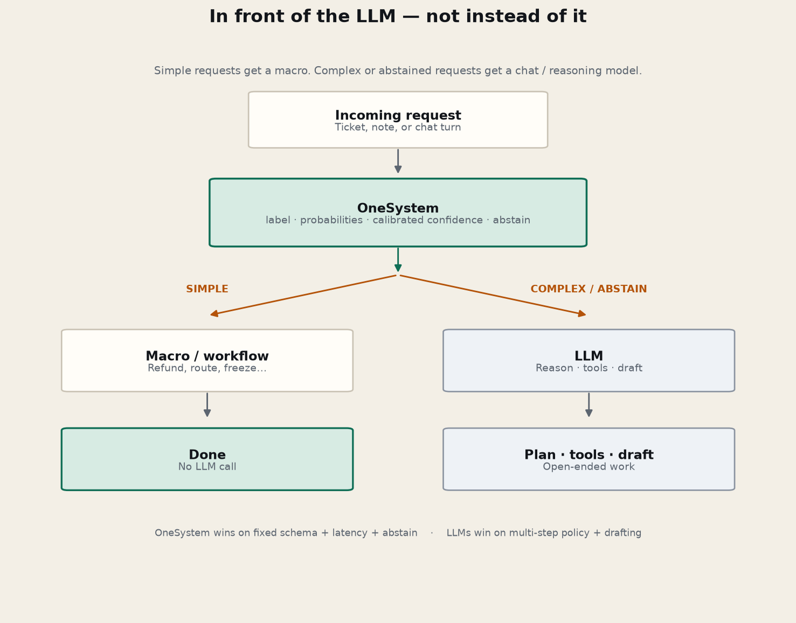
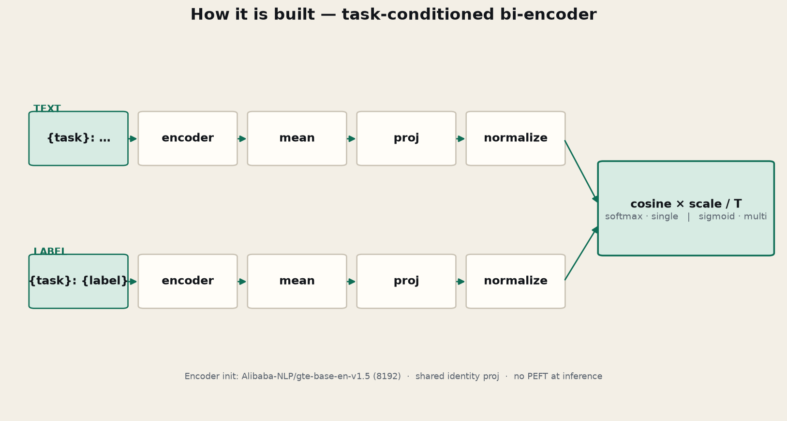

# OneSystem

**A production-ready System‑1 decision engine for LLM pipelines.**

Pass a short document and the labels that are legal for a decision. OneSystem returns a typed answer, a probability table, and calibrated confidence in **one forward pass**. It does **not** generate text. It sits **in front of** chat / reasoning models so simple requests never pay for an LLM call.

**Repo:** [github.com/kiranbeethoju/onesystem](https://github.com/kiranbeethoju/onesystem) · **Release:** [v0.3.0](https://github.com/kiranbeethoju/onesystem/releases/tag/v0.3.0) · **Offline zip:** [offline_bundle.zip](https://github.com/kiranbeethoju/onesystem/releases/download/v0.3.0/offline_bundle.zip) · **Cookbook:** [kiranbeethoju.github.io/onesystem](https://kiranbeethoju.github.io/onesystem/) · **Benchmarks:** [BANKING77 · CLINC150 · HWU64 · GoEmotions](https://kiranbeethoju.github.io/onesystem/benchmarks.html) · **Comparison:** [vs Laya / OpenJev](https://kiranbeethoju.github.io/onesystem/comparison.html) · **AI brief:** [docs/APP_BRIEF.md](docs/APP_BRIEF.md) · **Offline guide:** [scripts/offline_bundle.md](scripts/offline_bundle.md)

---

## 1. What is OneSystem?

OneSystem is a **standalone classifier** (own weights, ~550 MB). Not a chat model. Not a LoRA on someone else’s decision checkpoint.

| You need | OneSystem |
|---|---|
| One label from a fixed set | Native (softmax) |
| Several tags at once | Native (sigmoid + threshold) |
| Urgency / severity scale | Ordinal `score` |
| Calibrated confidence | Temperature fit after training |
| “Don’t guess — escalate” | `min_confidence` → `abstain` |
| Draft an email / plan / tool calls | **No** — hand off to an LLM |

Architecturally closer to embedding classifiers (BGE / E5 / GTE) than to an LLM.

---

## 2. Why not use an LLM for every request?

Many tickets only need: document type? urgency? department? handoff?

That is **routing**, not reasoning. An LLM is slower, costlier, and less deterministic for fixed schemas.

| | OneSystem (System‑1) | Chat / reasoning LLM (System‑2) |
|---|---|---|
| Purpose | Typed decision engine | Reasoning, planning, generation |
| Generates text | No | Yes |
| Fixed schema + probabilities | Native | Prompted |
| Calibration & abstain | Designed in | Usually prompted |
| Latency / cost | Very low locally | Higher |
| Best for | Route, filter, prioritize | Synthesis, tools, drafts |

**Bottom line:** put OneSystem **in front of** your LLM — don’t replace the LLM with it.

---

## 3. How it fits in a pipeline



**Simple** — *“I need a refund for the duplicate March charge.”* → refund macro, no LLM.  
**Complex / abstain** — multi-step policy, low confidence, or model error → your chat API.

Regenerate diagrams: `python scripts/render_diagrams.py` (matplotlib).

---

## 4. Install — online, offline, or no `pip install`

### 4a. Online (normal)

```bash
git clone https://github.com/kiranbeethoju/onesystem.git
cd onesystem
pip install -e .          # needs torch, transformers<5, safetensors
# First load downloads v0.3.0 weights from GitHub Releases if models/onesystem/ is empty
python -c "from onesystem.model import OneSystem; print(OneSystem.load().classify('hi', {'x':['a','b']}))"
```

### 4b. Air-gapped Linux (no internet) — download source + weights elsewhere

**Fastest path:** download [offline_bundle.zip](https://github.com/kiranbeethoju/onesystem/releases/download/v0.3.0/offline_bundle.zip) on a connected machine (source + `models/onesystem` weights), copy to the isolated host, unzip. Still ship a `wheelhouse/` of `requirements.txt` wheels for torch/transformers if those are not already installed.

On an **isolated** machine you cannot reach PyPI, Hugging Face, or GitHub. Prepare a bundle on a connected host, then copy it over (USB / scp).

**Connected machine — pack source, weights, and dependency wheels:**

```bash
git clone --depth 1 --branch v0.3.0 https://github.com/kiranbeethoju/onesystem.git
cd onesystem

# Weights (~550 MB) into models/onesystem/  — see scripts/offline_bundle.md for the full file list
mkdir -p models/onesystem/encoder
# …download release assets into models/onesystem/ (model.safetensors, tokenizer*, encoder/*)…

python3 -m venv /tmp/os-venv && source /tmp/os-venv/bin/activate
pip install -U pip
mkdir -p wheelhouse
pip download -r requirements.txt -d wheelhouse/   # match target Python + OS + CPU/GPU

cd .. && tar -czf onesystem-offline.tgz onesystem/
```

**Isolated machine — install from the tarball only:**

```bash
tar -xzf onesystem-offline.tgz && cd onesystem
python3 -m venv .venv && source .venv/bin/activate
pip install --no-index --find-links=wheelhouse -r requirements.txt
```

### 4c. Use **without** `pip install -e .` (PYTHONPATH)

If you already have `torch` / `transformers` / `safetensors` (from the wheelhouse or a site package) and only need the OneSystem package from source:

```bash
cd onesystem
export PYTHONPATH="$PWD:$PYTHONPATH"

# REQUIRED on air-gap: pass the local checkpoint path (never rely on GitHub download)
python - <<'PY'
from onesystem.model import OneSystem
model = OneSystem.load("models/onesystem")   # local directory with model.safetensors
print(model.classify(
    "Patient denies chest pain. PMH not available.",
    {
        "chest_pain": {"labels": {
            "affirmed": "chest pain: present",
            "negated": "chest pain: denied",
            "uncertain": "chest pain: possible",
            "not_mentioned": "chest pain: not in note",
        }},
        "pmh": {"labels": {
            "documented": "PMH listed",
            "not_available": "PMH missing / unknown",
            "none": "no significant PMH",
        }},
    },
    min_confidence=0.4,
))
PY
```

| Do (air-gap) | Don’t |
|---|---|
| `OneSystem.load("models/onesystem")` | `OneSystem.load()` when weights are missing → tries GitHub |
| Ship `wheelhouse/` + `requirements.txt` | `pip install` from PyPI / HF at runtime |
| Keep `models/onesystem/encoder/*.py` with the weights | Delete encoder architecture files |
| `export PYTHONPATH=repo_root` if skipping editable install | Expect Hub downloads for the encoder |

Full checklist: [`scripts/offline_bundle.md`](scripts/offline_bundle.md). Smoke test: `python examples/run_recipes.py --model models/onesystem`.

### 4d. Load a model (general or domain)

| Domain | Load | After training |
|---|---|---|
| **General v0.3.0** | `OneSystem.load("models/onesystem")` | release assets in that folder |
| **BANKING77** | `OneSystem.load("models/onesystem-banking77")` | `python benchmarks/run_banking77.py` |
| **CLINC150** | `OneSystem.load("models/onesystem-clinc150")` | `python benchmarks/run_clinc150.py` |
| **HWU64** | `OneSystem.load("models/onesystem-hwu64")` | `python benchmarks/run_hwu64.py` |
| **GoEmotions** | `OneSystem.load("models/onesystem-goemotions")` | `python benchmarks/run_goemotions.py` |
| **Your taxonomy** | `OneSystem.load("models/onesystem-mydomain")` | `python -m onesystem.domain_adapt …` |

```python
from onesystem.model import OneSystem

model = OneSystem.load("models/onesystem")  # prefer explicit path offline
banking = OneSystem.load("models/onesystem-banking77")
d = banking.classify(
    "I want to transfer money to savings",
    {"intent": ["transfer", "balance", "other"]},  # use the full frozen set in prod
    min_confidence=0.65,
)
```

---

## 5. When OneSystem fails — hit your LLM API

Abstain, exception, or a complex label should call a **custom OpenAI-compatible** endpoint (OpenAI, Azure, vLLM, Groq, …). On a fully offline host, point `LLM_API_URL` at a **local** OpenAI-compatible server (vLLM / llama.cpp / etc.) or skip the LLM and queue a human.

```python
import json, os, urllib.request
from onesystem.model import OneSystem

model = OneSystem.load("models/onesystem")
LLM_URL = os.environ.get("LLM_API_URL", "https://api.openai.com/v1/chat/completions")
LLM_KEY = os.environ.get("LLM_API_KEY", "")

def call_llm(text: str, reason: str) -> str:
    body = {
        "model": os.environ.get("LLM_MODEL", "gpt-4o-mini"),
        "messages": [
            {"role": "system", "content": f"OneSystem could not resolve this ({reason}). Help the user."},
            {"role": "user", "content": text},
        ],
    }
    req = urllib.request.Request(
        LLM_URL,
        data=json.dumps(body).encode(),
        headers={"Authorization": f"Bearer {LLM_KEY}", "Content-Type": "application/json"},
        method="POST",
    )
    with urllib.request.urlopen(req, timeout=60) as resp:
        return json.loads(resp.read().decode())["choices"][0]["message"]["content"]

def handle(text, labels):
    try:
        intent = model.classify(text, {"intent": labels}, min_confidence=0.65)["intent"]
    except Exception as exc:
        return {"route": "llm", "reply": call_llm(text, f"error:{exc}")}
    if intent.get("abstain") or intent.get("label") in {None, "other", "complex"}:
        return {"route": "llm", "reply": call_llm(text, "abstain_or_complex"), "decision": intent}
    return {"route": "macro", "action": f"macro:{intent['label']}", "decision": intent}
```

Full pattern: [LLM fallback](https://kiranbeethoju.github.io/onesystem/#llm-fallback) · Colab: [`examples/colab_usecases.py`](examples/colab_usecases.py)

---

## 6. Medical / clinical decision schemas (demo — not a device)

OneSystem does **not** parse clinical text like a dedicated NLP stack. You define **typed questions** (one head per concept). For negation and history:

1. **Per-finding polarity** — `chest_pain`, `mi_history`, `fever` each with `affirmed / negated / uncertain / not_mentioned`
2. **History availability** — `documented / not_available / none_significant / family_only`
3. **Next action** — `extract_ok / ask_history / confirm_negation / escalate_llm`
4. On `abstain` or `escalate_llm` → call your LLM / clinician (never invent a diagnosis)

**Not a medical device.** Do not use as the sole basis for diagnosis or treatment. For production clinical NLP, label notes and run `domain_adapt`.

### Example — negated findings + missing PMH

```python
from onesystem.model import OneSystem

model = OneSystem.load("models/onesystem")
note = (
    "Patient denies chest pain and denies history of myocardial infarction. "
    "Past medical history is not available at this time."
)

def polarity(finding):
    return {"labels": {
        "affirmed": f"{finding}: present / positive",
        "negated": f"{finding}: denied / no / without",
        "uncertain": f"{finding}: possible / suspected",
        "not_mentioned": f"{finding}: not in this note",
    }}

out = model.classify(
    note,
    {
        "chest_pain": polarity("chest pain"),
        "mi_history": polarity("history of myocardial infarction"),
        "pmh_availability": {"labels": {
            "documented": "PMH listed with conditions",
            "not_available": "PMH unavailable / unknown / not obtained",
            "none_significant": "no significant past medical history",
        }},
        "next_action": {"labels": {
            "extract_ok": "fields clear enough to store",
            "ask_history": "ask for missing past medical history",
            "confirm_negation": "confirm a denial is real",
            "escalate_llm": "hand off to LLM or clinician",
        }},
    },
    min_confidence=0.4,
)
# Local run (v0.3.0 general): mi_history=negated (0.53), next_action=ask_history (0.47);
# chest_pain abstained → escalate that head to LLM / human.
```

### Example — family history vs patient diagnosis

```python
out = model.classify(
    "Family history is significant for colon cancer in father at age 55. "
    "Patient has no personal history of malignancy.",
    {
        "colon_cancer": {"labels": {
            "patient_current": "patient has colon cancer now",
            "patient_past": "patient had colon cancer before",
            "family_only": "relative has colon cancer, not the patient",
            "denied_patient": "patient denies personal malignancy history",
            "not_mentioned": "colon cancer not discussed",
        }},
        "pmh_availability": {"labels": {
            "documented": "PMH listed",
            "not_available": "PMH missing",
            "none_significant": "no significant PMH",
            "family_only": "only family history is given",
        }},
    },
    min_confidence=0.4,
)
# Local run: colon_cancer=family_only (0.40), pmh_availability=family_only (0.72)
```

Re-run all cookbook cases locally: `python examples/run_recipes.py --model models/onesystem --out docs/data/recipes.json`

---

## 7. Domain recipe table (local smoke — general v0.3.0)

Produced with `examples/run_recipes.py` on CPU against `models/onesystem`. Full JSON: [`docs/data/recipes.json`](docs/data/recipes.json) · live cookbook: [Cookbook](https://kiranbeethoju.github.io/onesystem/#cookbook)

| Domain | Case | Strong heads (local) | Notes |
|---|---|---|---|
| **Clinical NLP** | Negated MI + missing PMH | `mi_history=negated` 0.53 · `next_action=ask_history` 0.47 | `chest_pain` abstained → escalate |
| **Clinical NLP** | Family hx colon cancer | `colon_cancer=family_only` 0.40 · `pmh=family_only` 0.72 | Correct attribution pattern |
| **Clinical triage** | Chest-pain intake | `disposition=ed_now` 0.72 · `red_flags.chest_pain` 0.99 | Schema demo only — not a device |
| **E-commerce** | Double charge + no ship | `intent=refund_request` 0.69 · `handoff=yes` 0.76 | Urgency score ≈ 1.92 |
| **Fintech** | Fraud freeze card | `intent=freeze_card` 0.95 · `products.debit_card` 0.98 | `risk` abstained |
| **EdTech** | Gradebook before midterm | `intent=grade_issue` 0.89 · `needs_human=yes` 0.92 | Subject abstained (math ~0.40) |
| **Ops** | Deploy 500s | `urgent=yes` 0.87 | Severity / area abstain → human |

Tip: use **short contrastive label descriptions**; prefer **one head per finding** for negation/history; treat abstain as success (escalate), not failure.

---

## 8. Performance, context, calibration

| Metric | v0.3.0 |
|---|---|
| Encoder init | [`Alibaba-NLP/gte-base-en-v1.5`](https://huggingface.co/Alibaba-NLP/gte-base-en-v1.5) (Apache 2.0, **8192** ctx) |
| Text context | **8192 tokens** (~6k–7k English words), incl. task prefix |
| Label context | **128 tokens** |
| Local holdout (fast-decisions) | Zero-shot **0.457** → fine-tuned **0.590** · ECE **0.057** · T **2.5** |
| BANKING77 test (77-way) | Current **63.3%** → domain-adapted **94.0%** |
| CLINC150 in-scope (150-way) | Current **73.0%** → domain-adapted **97.6%**; OOS recall **91.7%** (threshold from val) |
| HWU64 test (64-way) | Current **64.5%** → domain-adapted **93.7%** |
| GoEmotions (27-way multi-label) | Macro-F1 **8.3%** → **61.0%** · micro-F1 **64.8%** |
| Weights | ~550 MB `model.safetensors` + `encoder/` architecture code |

Scores are dataset-specific — see [benchmarks](https://kiranbeethoju.github.io/onesystem/benchmarks.html). Prefer **2–16** labels per task in production schemas.

### Train a domain checkpoint

```bash
python -m onesystem.domain_adapt \
  --train data/my_domain/train.jsonl \
  --output models/onesystem-mydomain \
  --name OneSystem-MyDomain \
  --epochs 4
```

---

## 9. How it is trained



- Data: public [`fastino/fast-decisions`](https://huggingface.co/datasets/fastino/fast-decisions) development split — 70% train / 10% calib / 20% eval per domain.
- Recipe: AdamW; **max_text_len=8192**, **max_label_len=128**; temperature on calib only.
- Pure PyTorch + Transformers (`transformers>=4.49,<5`) — `python -m onesystem.train` / `onesystem.evaluate`.

---

## 10. Domain recipes (quick)

Schemas are yours at inference. Full examples + JSON: [kiranbeethoju.github.io/onesystem](https://kiranbeethoju.github.io/onesystem/).

**E-commerce** · **Financial** · **EdTech** · **Clinical NLP / triage (demo only)** · **Ops / incident urgency**

```python
model.classify(
    "The deploy failed twice and customers are seeing 500s. Can someone look now?",
    {
        "urgent": {
            "labels": {
                "yes": "Does this need attention right now?",
                "no": "This can wait",
            }
        }
    },
)
```

CLI (after `pip install -e .`): `onesystem "Stop the bot and get me a person." --task handoff --labels yes,no`  
Without install: `python -m onesystem.cli "…" --task handoff --labels yes,no` with `PYTHONPATH` set.

---

## Layout, contribute, license

| Path | Role |
|---|---|
| `onesystem/model.py` | `classify` / abstain / label cache |
| `onesystem/modeling.py` | Network + save/load |
| `onesystem/hub.py` | Local dir or GitHub release download |
| `onesystem/train.py` / `evaluate.py` | Train, calibrate, ECE |
| `onesystem/domain_adapt.py` | Fine-tune a domain-specific checkpoint |
| `benchmarks/` | BANKING77 / CLINC150 / HWU64 / GoEmotions |
| `examples/run_recipes.py` | Offline cookbook smoke tests → `docs/data/recipes.json` |
| `examples/colab_usecases.py` | Colab multi-use-case script |
| `scripts/offline_bundle.md` | Air-gap pack / unpack checklist |
| `requirements.txt` | Pins for `pip download` wheelhouse |
| `scripts/render_diagrams.py` | Pipeline + architecture PNGs |
| `assets/` · `docs/assets/` | Diagram images for README / Pages |
| `docs/` | GitHub Pages cookbook |
| `models/onesystem` | Config, tokenizer, encoder code, weights |

See [CONTRIBUTING.md](CONTRIBUTING.md). Apache 2.0 — [LICENSE](LICENSE), [NOTICE](NOTICE).
